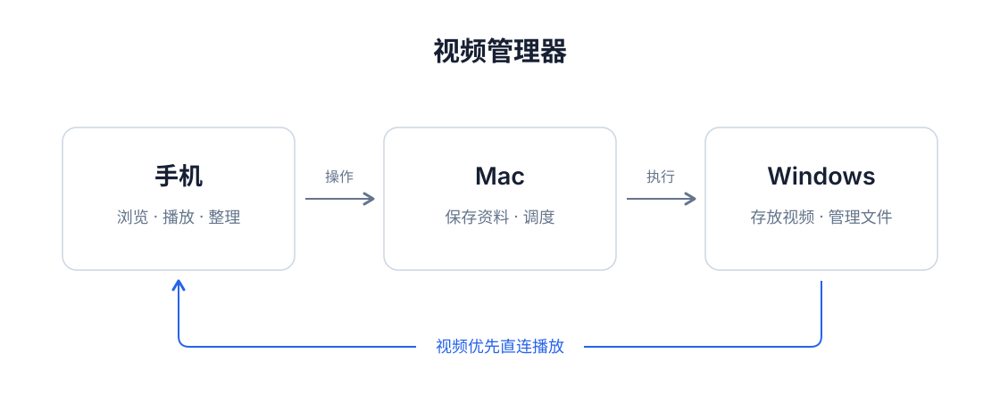

# 视频素材管理器

**手机负责操作，Mac 保存资料并调度，Windows 保存原文件。**

用手机浏览电脑里的视频、全屏播放、打点、评分、管理演员和标签；也能直接整理电脑上的文件夹与文件。当前 Android 面板版本为 **1.1.8**。



> 先看图中的三条路径：**资料走调度中心，视频优先直连存储设备，剪辑交给处理器。** 单机运行时，调度中心会内置文件服务和处理线程，不必准备多台设备。

## 能做什么

- **浏览与播放**：按真实目录浏览文件；全屏播放、同目录选集、上下滑切换、长按快进/快退、隐藏控件。
- **整理素材**：打点、标签、演员、评分；演员可改名，作品关联保持；素材可按评分升降序排列并记住选择。
- **管理真实文件**：文件夹、普通文件和视频可混选，支持批量删除、移动；也支持重命名与新建文件夹。移动限定在同一登记存储内。
- **手机上传**：上传到点击上传时所在的目录，显示进度与失败原因；同名文件不会覆盖。
- **后台处理**：ffmpeg 探测、缩略图、剪辑任务；元数据缓存在手机，支持离线修改后同步。真实文件操作需要对应设备在线。

## 三分钟理解代码

```text
packages/
├── panel/          手机 / Web 面板：React + TypeScript + Vite + Capacitor
├── coordinator/    数据与调度中心：Flask + SQLite；默认端口 8787
├── connector/      存储设备上的文件服务：扫描 / 串流 / 文件操作；默认端口 8788
├── processor/      ffmpeg 执行器：探测 / 缩略图 / 剪辑
└── shared/         Python / TypeScript 的领域与协议契约
scripts/            启动、验证、共享契约同步
config/             配置示例；真实的本机配置不提交
tests/             临时数据库与临时文件上的回归测试
docs/              项目逻辑图、当前架构、部署和历史设计文档
archive/prototype/ 原 GitHub 早期剪辑原型，保留源码与历史，不参与当前构建
```

## 先跑单机版

需要 **Python 3.11+、Node.js 22、ffmpeg / ffprobe**。在仓库根目录执行：

```bash
python3 -m venv .venv
source .venv/bin/activate
python -m pip install -r requirements.txt
./scripts/start-coordinator.sh
```

另开终端启动面板：

```bash
cd packages/panel
npm ci
npm run dev
```

打开终端显示的 Web 地址。在顶部点“未连接 PC”，输入 `http://<调度中心IP>:8787` 和后端终端打印的六位配对码。首次启动会创建演示资料；到设置中登记自己的存储目录后，扫描真实文件。演示条目不是你的真实文件。

## 多设备部署

让 Mac 长期开调度中心，Windows 运行连接器；有算力的设备再启动处理器：

1. 将 `config/coordinator.env.example` 复制为 `config/coordinator.local.env`，将 `VM_MODE` 改为 `coordinator`，再启动调度中心。
2. 在 Windows 安装 `packages/connector/requirements.txt`。可以直接运行连接器进入配对模式，在手机设置中按提示接入。
3. 若使用环境变量注册，将 `packages/connector/run.local.example.bat` 复制为 `run.local.bat`，填本机地址、存储根目录和调度中心打印的 enrollment token，然后运行 `run.bat`。
4. 需要远程处理时，用相同方式配置并启动 `packages/processor/run.bat`，确保 ffmpeg / ffprobe 在 PATH 中。

详细步骤见 [部署指南](docs/deployment.md)，读写路径见 [当前架构](docs/architecture.md)。

## 构建 Android APK

需要 JDK 21、Android SDK Platform 34，以及可用的 Gradle / Android Maven 下载源。

```bash
cd packages/panel
npm ci
npm run build
npx cap sync android
cd android
# 按自己的电脑设置 JAVA_HOME 和 ANDROID_HOME；也可配置未跟踪的 local.properties。
./gradlew assembleDebug
```

产物：`packages/panel/android/app/build/outputs/apk/debug/app-debug.apk`。Windows 下使用 `gradlew.bat assembleDebug`。仓库保存可复现的源码与依赖锁文件，不把本地 APK、SDK 或依赖目录作为源码提交。

## 验证

```bash
# 已安装 Python 依赖，并在 packages/panel 执行过 npm ci
python3 scripts/check.py
npm --prefix packages/panel run build
```

测试覆盖目录与路径边界、文件移动 / 删除 / 上传、演员改名、批量操作失败重试、评分排序、播放范围和手势。测试只使用临时数据。GitHub Actions 会验证 Python 与面板构建。

## 文件与凭据边界

SQLite、原视频、缩略图、节点状态文件、真实 enrollment token、签名密钥、本机地址配置均由各部署环境本地保存。仅在可信局域网或自己的 Tailscale 网络使用；当前 HTTP 配对模式不是面向公网的多用户服务。首次配对码由服务启动时打印。

[项目逻辑图源文件](docs/project-wireframe.svg) · [当前架构](docs/architecture.md) · [部署指南](docs/deployment.md) · [版本记录](CHANGELOG.md) · [早期原型](archive/README.md)
