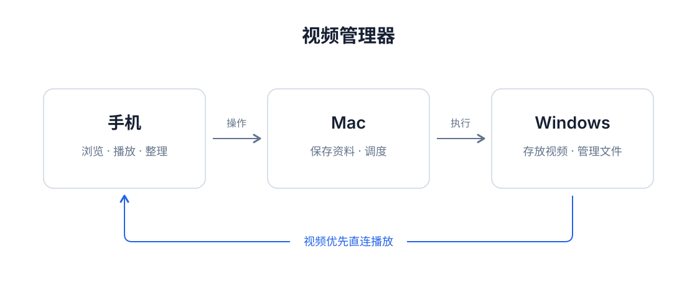
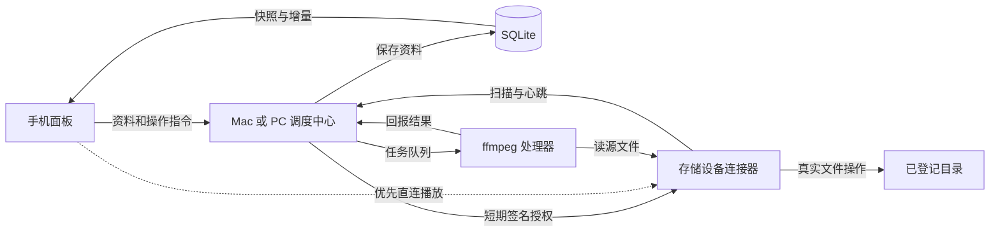

# 当前架构与读写路径

此文对应当前 1.1.8 面板和 1.1.7 文件操作接口。不要把早期原型的单体 server 当成当前部署入口。

## 谁负责什么

**手机面板 `packages/panel`** 展示目录和素材资料，缓存已同步元数据；评分、演员、标签、打点等修改经 Outbox 同步。文件移动、删除、新建和上传在线执行，不排入离线队列。目录页用 `LibraryPage.tsx`，播放器用 `VideoPlayer.tsx`，同步状态在 `store/library.tsx`。

**调度中心 `packages/coordinator`** 持有 SQLite 唯一权威数据库，维护素材、演员、标签、标记、存储、节点和任务。`app.py` 是 HTTP 入口，`writes.py` 修改元数据，`storage_files.py` 将文件操作路由到实际持有文件的设备，`jobs.py` 管任务。

**连接器 `packages/connector`** 部署在持有文件的设备，扫描登记根目录，回报索引、发送心跳，并按短期签名 ticket 提供串流与文件操作。连接器不直接访问 SQLite，也不执行 ffmpeg。`filesystem.py` 负责路径范围、同名冲突和文件 I/O。

**处理器 `packages/processor`** 从调度中心领取任务，从连接器读取视频，运行 ffmpeg / ffprobe，再回报探测、缩略图或剪辑结果。处理器也不直接写 SQLite。

## 两种部署

- `VM_MODE=monolith`：默认单机模式。调度中心内置 loopback 节点和本地处理线程；手机只需配对这台电脑。
- `VM_MODE=coordinator`：纯调度中心。远程存储设备运行连接器，另行部署处理器。Mac + Windows 是此模式的一种实例，不要求固定主机名。

## 一次操作怎样走

1. **浏览目录**：手机请求 `/api/storages/<id>/entries`；本地存储由调度中心读取，远程存储由连接器读取；返回目录与普通文件，不只返回已索引视频。
2. **修改评分等资料**：面板乐观更新缓存，在线刷新 Outbox；调度中心写入 SQLite 并推进 revision。演员改名在线执行，事务内更新演员资料、标签和作品关联。
3. **播放**：面板请求 stream-locate，取得直连与代理地址；可达时直接从连接器读取 Range 视频流，否则回落到调度中心代理。
4. **移动 / 重命名 / 删除**：调度中心确认已登记存储和路径，签发绑定路径及用途的 ticket；连接器执行实际文件操作。移动成功后，调度中心保留视频 ID、打点和演员等资料并更新路径；部分失败项可重试。
5. **新建与上传**：新建用目录接口 POST，上传用 `/api/storages/<id>/files` PUT。目标由点击上传时的目录确定。上传临时文件完成后才发布，同名目标不覆盖；视频会登记索引。
6. **评分排序**：前端本地排序，不更改文件。文件夹置顶；有效评分按指定方向排序，未评分和普通文件置后。选择保存在设备本地，播放器同目录选集沿用排序。
7. **剪辑**：建立片段记录和任务，由本地线程或远程处理器取源、剪辑、上传成品与回报，最后由调度中心更新状态。

## 三类授权

手机用六位配对码换长期面板 token；连接器 / 处理器用 enrollment token 换节点身份；单次文件读取和变更使用各节点密钥签发的短期 ticket。不要把运行中的 state JSON 或本机配置放入版本库。

## 文档范围

本目录内其余中文设计文档保留原始背景和方案。当前入口、功能与操作语义以本文件、[README](../README.md) 和当前代码为准。`shared/` 中的协议文件是共享基础，新增接口以 coordinator 的路由实现为准。
